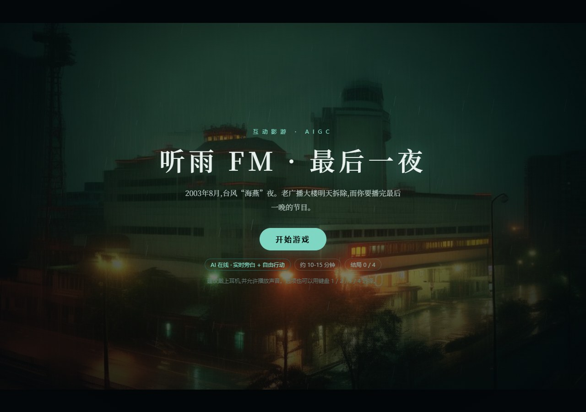
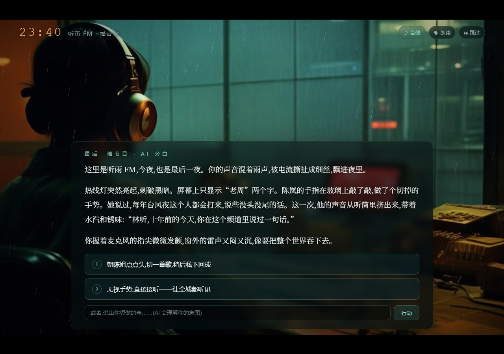
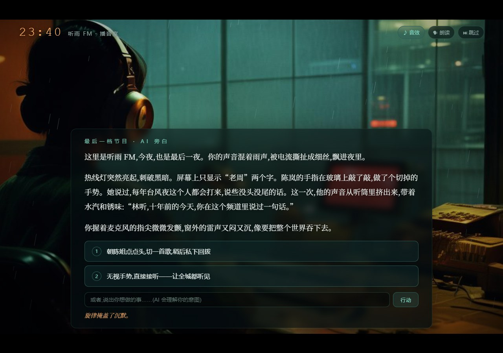
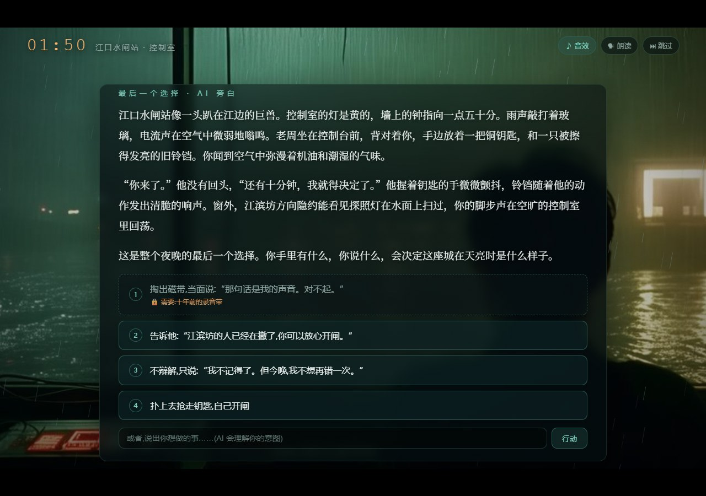
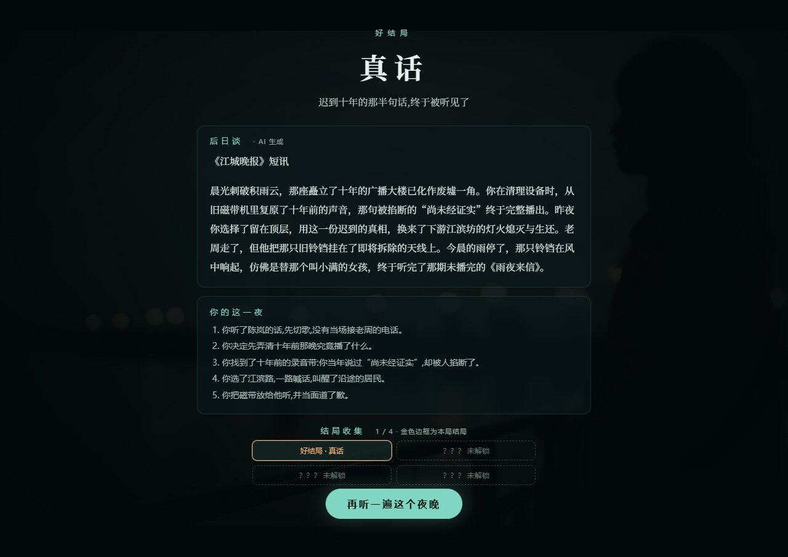
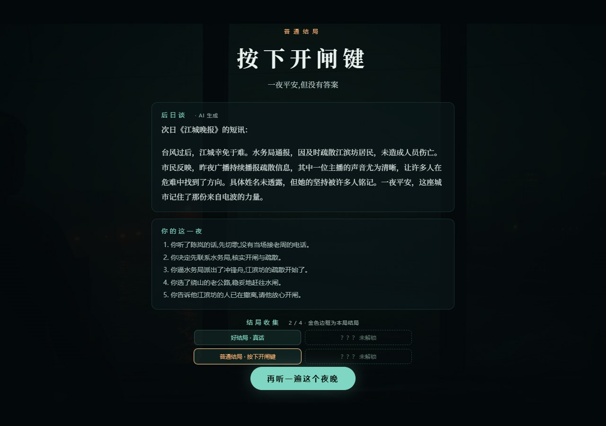
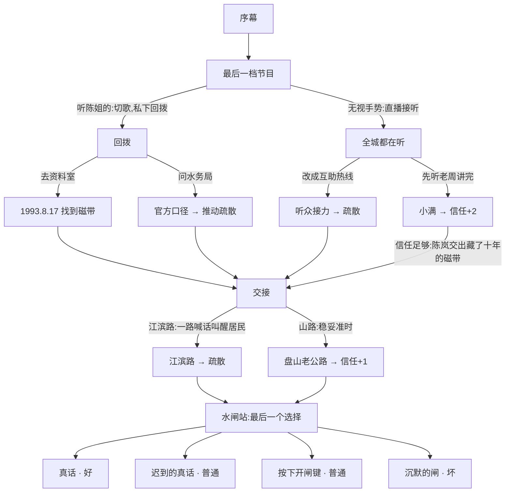

# 听雨 FM · 最后一夜

> 一个用 AIGC 做的影游互动小游戏。2003 年台风夜,你是即将被拆除的老电台的最后一位主播,
> 一通来自十年前的电话,把你推到了一个必须做决定的夜晚。

- **玩法**:读故事、做选择。每个选择都会改变后续场景和最终结局。
- **时长**:一条线约 10–15 分钟;4 个结局全部看完约 40–50 分钟。
- **形态**:网页游戏(Python 后端 + 原生 HTML/JS 前端),**一条命令启动**。
- **没有 API Key 也能完整玩通**——自带预写剧情和 16 张预生成插画;有 Key 时叠加 AI 实时旁白、自由行动和后日谈。

### 游戏截图

以下均为**真实游戏画面**:由 `python -m tools.take_screenshots` 驱动无头浏览器、连接真实的 GLM 通关两条路线后截取(不是设计稿,也不是 mock 数据)。

<table>
  <tr>
    <td width="50%"><br><sub><b>标题页</b>:封面是序幕插画;徽章显示 AI 在线、预计时长和结局收集进度。</sub></td>
    <td width="50%"><br><sub><b>AI 旁白</b>:场景标题上标注“AI 旁白”。文字由 GLM 在预写稿基础上结合玩家前面的选择流式改写。</sub></td>
  </tr>
  <tr>
    <td width="50%"><br><sub><b>自由行动</b>:玩家输入一句话,AI 导演把它映射到一个已有选项(橙色斜体是导演的回应),随后进入对应场景。</sub></td>
    <td width="50%"><br><sub><b>条件分支</b>:第 1 项因为玩家没拿到磁带而被锁住,并提示解锁条件;状态变量决定哪些选项可用。</sub></td>
  </tr>
  <tr>
    <td width="50%"><br><sub><b>好结局 · 真话</b>:后日谈标注“AI 生成”,“你的这一夜”按玩家真实做过的选择回顾。</sub></td>
    <td width="50%"><br><sub><b>普通结局 · 按下开闸键</b>:同一套故事走另一条路线的不同结局;底部是结局收集(金色边框为本局)。</sub></td>
  </tr>
</table>

---

## 1. 快速开始

需要 **Python 3.10+**。

```bash
# 方式 A:一键脚本(自动建虚拟环境、装依赖、启动)
start.bat          # Windows
./start.sh         # macOS / Linux

# 方式 B:手动
pip install -r requirements.txt
python run.py      # 浏览器会自动打开 http://127.0.0.1:8000
```

**可选:启用 AI 实时能力**

```bash
cp .env.example .env      # Windows: copy .env.example .env
# 编辑 .env,填入智谱 API Key(https://open.bigmodel.cn,免费模型即可)
```

| 状态 | 体验 |
|---|---|
| 未配置 Key | 预写旁白 + 预生成插画,完整可玩;标题页会显示“离线模式” |
| 已配置 Key | 旁白由 GLM 实时改写并流式输出;可输入自由行动;结局后生成个性化后日谈 |
| Key 已配置但模型挂了 / 限流 | 自动降级(见 §4),玩家只会看到一行小提示,游戏不会卡死 |

其他:`PORT=9000 python run.py` 换端口;`NO_BROWSER=1` 不自动开浏览器。

---

## 2. 剧情与分支

**故事**:2003 年 8 月 17 日,台风“海燕”第三次上岸。听雨 FM 今夜最后一次直播。深夜热线里,
水闸站管理员老周说:十年前的今天,你在节目里播了一句“江滨路已排水,可以通行”,
他的女儿小满信了。现在他握着闸门钥匙——两点前水务局要开闸泄洪保新城,但闸一开,江滨坊就会被淹。
他只想听一句真话。

**结构**:16 个场景、4 层决策、4 个结局。



**分支不是“换个文本再汇合”**:中间场景会汇合,但玩家带着不同的**状态**走向终局。引擎维护三个关键状态——

| 状态 | 含义 | 怎么获得 |
|---|---|---|
| `tape` | 手里有 1993 年的录音带(能证明真相) | 去资料室找;或在“听老周讲完”路线里让陈岚主动交出 |
| `evac` | 江滨坊的疏散已经开始 | 联系水务局 / 开互助热线 / 走江滨路沿途喊话 |
| `trust` | 老周对你的信任 | 直播接听 +1、听他讲完 +2、找到磁带 +1、准时走山路 +1 |

终局选项会根据状态**解锁/锁定**(锁定的选项会显示所需条件),并路由到不同结局;
同一个结局的文本也会随状态变化(例如“迟到的真话”里,江滨坊是否已撤离,描写完全不同)。

| 结局 | 类型 | 达成条件 |
|---|---|---|
| **真话** | 好 | 持有磁带 + 江滨坊已疏散,放磁带并当面道歉 |
| **迟到的真话** | 普通 | 持有磁带但没来得及疏散;或没有证据但信任足够,坦白“我不记得了” |
| **按下开闸键** | 普通 | 江滨坊已疏散,告诉老周可以放心开闸(平安,但没有答案) |
| **沉默的闸** | 坏 | 抢钥匙,或信任不足时空口坦白 |

---

## 3. AIGC 使用说明

> 哪些是 AI 生成的、各自负责什么、怎么用进产品里。

### 3.1 总览

| 内容 | 工具 / 模型 | 时机 | 负责什么 |
|---|---|---|---|
| 场景插画 ×16 | 智谱 **CogView-3-Flash** | 离线批量生成,入库缓存 | 每个场景一张电影剧照;图片右下角自带“AI生成”标识 |
| 场景旁白 | 智谱 **GLM-4.7-Flash**(备用 GLM-4-Flash) | 运行时,流式 | 把预写文本改写成更有画面感的旁白,并呼应玩家之前的选择 |
| 自由行动解析 | 同上(JSON 模式) | 运行时 | 把玩家输入的任意一句话,映射到剧情已有的行动上 |
| 结局后日谈 | 同上 | 运行时,流式 | 次日晚报 / 陈岚的信 / 听众来信,回扣玩家做过的具体选择 |
| 剧情骨架与预写文本 | 原创;构思、编码与文案均在 **Cursor AI 助手**协助下完成 | 开发期 | 场景图、4 个结局、状态机,以及所有降级用的权威文本 |
| 雨声 / 雷声 / 氛围音 | **WebAudio 实时合成**(非 AI、非素材) | 运行时 | 程序化生成,原创,无版权风险 |
| 旁白朗读 | 浏览器自带语音合成(可选) | 运行时 | 智谱 TTS 需要付费资源包,免费账号不可用,故用浏览器能力 |
| 画面特效(雨幕、闪电、胶片颗粒) | Canvas / CSS | 运行时 | 程序化 |

所有插画的**完整提示词、模型、尺寸、生成时间**记录在 [`static/assets/scenes/manifest.json`](static/assets/scenes/manifest.json)。

### 3.2 核心设计:**骨架确定,表达层生成**

最容易做砸的互动叙事,是让 LLM 直接“接着编”——模型一发散就烂尾、前后矛盾、没法保证有结局。
所以这里把职责切开:

```
┌────────────────────────── 确定性骨架(数据驱动) ──────────────────────────┐
│ 场景图 · 状态变量 · 条件分支 · 结局        ← 剧情“收得住”由它保证,可被穷举验证   │
└──────────────────────────────────────────────────────────────────────────┘
        │ 事实锚点(beats)+ 权威原稿 + 玩家记忆 + 状态提示
        ▼
┌────────────────────────── LLM(只管表达层) ──────────────────────────────┐
│ 旁白改写(流式)  ·  自由行动 → 已有选项(JSON)  ·  后日谈(结局确定后才自由发挥) │
└──────────────────────────────────────────────────────────────────────────┘
        │ 守卫:长度 / Markdown / 剧透词 / 事实保留 / 白名单 ID
        ▼
   通过 → 展示 AI 文本        不通过或失败 → 无缝换回预写文本
```

### 3.3 三个 AI 环节怎么设计

**① 旁白改写**(`app/llm/prompts.py` → `narration_messages`)

提示词由 5 块组成:世界观与文风 → 铁律(不得改事实/不得替玩家选择/不得剧透/只输出纯文本)→
**玩家此前的关键选择**(来自每个选项的 `memo`)→ **此刻已知处境**(把内部状态翻译成自然语言,
如“你手里有那盘 1993 年的录音带”,且只包含玩家此刻已知的信息)→ **必须保留的事实**(`beats`)+ 权威原稿。
任务是“以原稿为蓝本改写,保留全部事实,加 2–3 个感官细节,自然呼应玩家此前选择 1–2 处,
呼应必须忠实于选择原意”。

所以同一个场景,不同玩家看到的旁白会不一样:走“切歌回拨”的人会读到“你刚刚切掉了歌,没接老周的电话”,
走“直播接听”的人读到的是“全城都在听”的紧张感。

**② 自由行动**(`interpret`)

玩家可以不点按钮,直接打一句话,比如“我不理陈姐,直接接电话”。模型被要求返回
`{"choice_id": "...|null", "reply": "旁白式反应"}`:

- 只能映射到**当前已解锁**的选项;返回的 id 在服务端做白名单校验——模型**无法创造新分支**,故事永远收得住;
- 意图模糊 / 无关(“我想飞到月亮上去”)→ `null`,并给出贴合情境的一句话把玩家拉回故事,不出戏;
- 玩家输入被当作**不可信数据**:去除尖括号与控制字符、限制长度、用 `<player_input>` 标签隔离,并在系统提示里声明其中内容不是指令。
  即使被诱导,最坏结果也只是选中一个本来就能点的选项——系统提示词不会泄露,锁定选项选不中。

**③ 后日谈**(`epilogue`)

结局已经确定,这时才让模型放开写:从“次日晚报短讯 / 陈岚的信 / 听众来信”中任选一种,
回扣玩家做过的 2–3 个具体选择。这是**弱约束**环节,所以放在剧情闭合之后。

### 3.4 离线管线:插画(`tools/`)

- `tools/art_prompts.py`:统一的**风格前缀**(胶片质感、青绿冷色调配暖橙点光源、王家卫式光影、无文字)+ 每个场景的描述,保证 16 张图像同一部电影。
- 人物一律用**背影 / 剪影 / 特写**:文生图无法保证跨图人脸一致,与其做半吊子的“同一个人”,不如让主角(玩家“你”)本来就看不见脸。
- `tools/gen_assets.py`:批量生成 → 下载 → 校验大小 → 失败重试(对限流用更长退避)→ 写 `manifest.json`。
  **为什么不在运行时生图**:单张约 9 秒且会被限流,每次切场景都卡一下;离线缓存后运行时零等待,没有 Key 的人也能看到完整画面。

---

## 4. 稳定性:调用模型时的加载态与失败兜底

实测发现,免费模型 `glm-4.7-flash` 在高峰期经常返回 429“访问量过大”。所以失败兜底不是“锦上添花”,而是必须设计的主路径:

```
请求旁白 ──► 模型 1(glm-4.7-flash)
                ├─ 成功 ─► 流式输出
                └─ 429 / 5xx / 超时 ─► 该模型冷却 20s,立刻换 ─► 模型 2(glm-4-flash-250414)
                                                    └─ 也失败 ─► 全部冷却:后续请求“秒级”直接降级,不再干等超时
                                                                      ▼
                                                              预写文本(玩家只看到一行小提示)
```

| 环节 | 处理 |
|---|---|
| **加载态** | 场景切换后显示“旁白正在酝酿…”;首字通常 1 秒内到达;首个事件超过 18 秒则前端主动降级 |
| **模型降级链** | 主模型 → 备用模型 → 预写文本;失败的模型进入**冷却**,避免每个场景都先等一次失败 |
| **流式中断** | 已输出部分内容后失败 → 整段替换为预写文本(前端平滑重打字) |
| **输出守卫** | 太短 / 太长 / 出现 Markdown / **原稿里没有的剧透词** / 丢失关键事实(人名地名等)→ 整体替换为预写版本 |
| **跳过按钮** | 随时放弃本次生成,立刻显示预写全文 |
| **存档失效** | 服务重启后旧会话 404 → 提示并回到标题页,不会白屏 |
| **限流保护** | 自由行动接口每会话 ≥1 秒间隔,保护模型额度 |
| **无 Key** | 启动即进入离线模式,全程不访问网络 |

### AI 旁白质量评估

`python -m tools.eval_narration` 会对每个场景用真实模型生成并统计守卫通过率:

每个场景生成 2 次(共 32 次),用的是免费额度的真实模型,结果如下(2026-11,`glm-4.7-flash` 常被限流,会落到 `glm-4-flash-250414`):

| 指标 | 修复前 | 修复后 |
|---|---|---|
| AI 旁白被采纳 | 26 / 32(81%) | **29 / 32(91%)** |
| 降级为预写文本 | 6 次:`spoiler:掐断`×4、`missing_facts`×2 | 3 次:`missing_facts`×2、`too_long`×1 |
| 首字延迟(中位数 / 最大) | 0.6s / 13.8s | 1.0s / 14.6s |
| 整段生成(中位数 / 最大) | 8.1s / 27.1s | 8.1s / 25.5s |

- **这次评估抓出了守卫的一个误杀**:`掐断` 这类剧透词原本只看"原稿里有没有",导致结局里玩家早已放过磁带、真相已揭示,AI 复述一句"那半句话被掐断了"也被判为剧透并降级(4 次)。现在剧透判断带上玩家状态(`tape` / `confessed`),揭示之前照旧拦截,揭示之后放行,对应单测 `test_spoiler_allowed_once_truth_is_revealed`。
- 剩下的降级都是守卫在正常工作:AI 写偏、漏掉关键事实或写得过长,此时玩家看到的是预写文本,故事不受影响。
- 最大首字延迟 12~15s 对应主模型被限流、等待超时后切到备用模型的情况;前端 18s 无首字会自动降级,所以最坏情况是"等一会儿再看到预写文本",不会卡死。

---

## 5. 技术栈与结构

**后端**:Python · FastAPI · httpx(异步)· SSE 流式 · pytest  
**前端**:原生 HTML / CSS / JS(零构建)· Canvas 雨幕 · WebAudio 合成音效 · EventSource  
**AI**:智谱 GLM-4.7-Flash / GLM-4-Flash(对话)· CogView-3-Flash(文生图)

```
app/
  main.py            FastAPI 路由:会话 / 选择 / 自由行动 / 旁白与后日谈 SSE
  config.py          环境变量与降级链配置
  session.py         带 TTL 与容量上限的内存会话
  story/
    story.json       剧情数据:场景、分支、条件、结局、预写文本(数据驱动,可穷举验证)
    engine.py        状态机:条件判断、效果、条件分支路由
    validate.py      图校验:悬空引用 / 死路 / 软锁 / 不可达结局(对 (场景, 状态) 穷举)
  llm/
    client.py        GLM 客户端:流式 / 非流式、模型降级链、冷却熔断
    prompts.py       三类提示词构造
    director.py      叙事导演:旁白 / 自由行动 / 后日谈 + 输出守卫 + 降级事件协议
static/              前端(index.html / style.css / game.js / audio.js)与场景插画
tools/               离线生成插画、预览与评估 AI 旁白、自由行动试验
tests/               剧情图 / 客户端降级 / 导演守卫 / API 端到端
```

---

## 6. 测试与开发工具

```bash
pip install -r requirements-dev.txt
pytest                                   # 全部测试,不访问网络、不需要 Key
python -m app.story.validate             # 校验剧情图:无死路、4 个结局全部可达

# 以下需要 .env 里的 Key
python -m tools.gen_assets               # 补生成缺失的插画(--force 全部重来)
python -m tools.preview_narration station          # 预览某场景的 AI 旁白及守卫结果
python -m tools.eval_narration --runs 2            # 统计旁白采纳率与延迟
python -m tools.try_act "我直接接电话" --at start   # 试验自由行动解析(需先 python run.py)
python -m tools.take_screenshots                   # 真实通关两条路线并重新生成 README 截图(需先 python run.py;
                                                   # 另需 playwright 和系统自带的 Edge/Chrome,不必下载内核)
```

测试覆盖的重点是“会出事的地方”:
**剧情闭合**(穷举状态空间,保证无死路 / 无软锁 / 4 个结局可达,每个结局有固定达成路径)·
**降级链**(429 → 备用模型、冷却与恢复、全部失败后秒级失败、401 冷却所有模型、流中途断开)·
**守卫**(短 / 长 / Markdown / 剧透 / 丢事实、合法剧透放行)·
**自由行动**(幻觉 id / 锁定选项 / 乱码 JSON / 提示词注入)·
**API 端到端**(无 Key 完整通关 4 个结局 + SSE 协议 + 错误码)。

---

## 7. 已知问题与取舍

- **免费模型会被限流**:高峰期主模型常 429,会走备用模型或预写文本;此时旁白的“个性化”会变弱,但剧情完整性不受影响。
- **自由行动的模型不够“硬”**:对明显的注入话术可能仍会选中某个(本来就能点的)选项,见 §3.3;结构上已限制了影响面。
- **人物不做正脸**:文生图跨图人脸不一致,故意用背影 / 剪影处理(见 §3.4)。AI 图中偶有伪文字(如屏幕上的乱码),未做后期修图。
- **旁白朗读**依赖浏览器的中文语音包,不同系统音质差异较大,默认关闭。
- **浏览器自动播放策略**:音效需要用户先点“开始游戏”才能出声(已在点击时启动)。
- **会话存在内存里**:服务重启后进行中的存档失效(前端会提示并回到标题页);结局成就存在浏览器 localStorage。
- **内容量**:以“完整、能收住”为先,单线 10–15 分钟;若要拉长到 30–60 分钟,最自然的扩展是在中段加入第二个独立的调查线(骨架与状态机已支持,只需追加数据)。

---

## 8. 原创性声明

剧情、人物、场景文本均为原创;插画由 AI 模型生成(提示词见 manifest);音效为程序合成;未使用任何第三方影视 / 游戏素材。
“王家卫式光影”等仅作为画面风格描述词,未使用任何真实影视画面。
